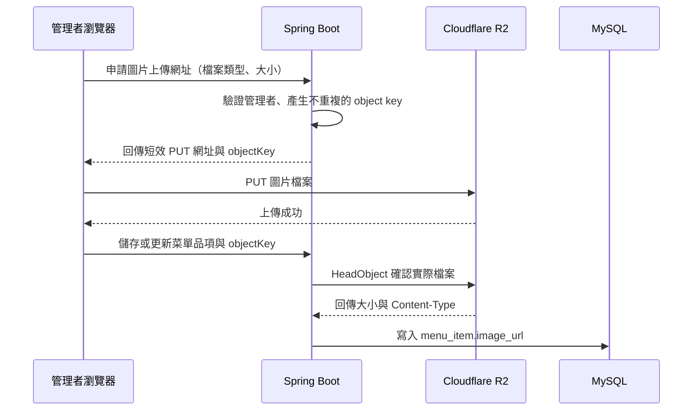

# Cloudflare R2 圖片上傳（React + Spring Boot）

這份教學從 Cloudflare 帳號已註冊開始，帶你建立 R2 儲存空間，並整理本專案串接商品圖片上傳的步驟。

## 先了解本專案目前的狀態

本專案使用 React、Spring Boot 與 MySQL。資料庫規格已預留 `menu_item.image_url`，但目前管理菜單畫面仍以 `imageText` 當圖片佔位，尚未接上實際檔案上傳。R2 帳號設定完成後，還需要實作後端簽發上傳網址、前端上傳，以及菜單資料儲存。

- [菜單與品項規格](../spec/modules/M1-菜單與品項.md)將圖片上傳列為延伸功能，基礎版本可以先使用圖片網址。
- [資料庫規格](../spec/03-資料庫設計.md)的 `menu_item` 已有 `image_url VARCHAR(500)`。
- Northwind 的 `Product` 是練習 API，不是火鍋菜單資料表；請依正式的 `menu_item` 規格串接。

## 上傳流程長什麼樣子

圖片由瀏覽器直接傳到 R2，Spring Boot 負責驗證管理者並簽發短效上傳網址。R2 憑證不會放進 React 前端。



## 1. 啟用 R2 並建立 Bucket

1. 登入 [Cloudflare Dashboard](https://dash.cloudflare.com/)，開啟 **Storage & databases → R2 object storage**。
2. 如果 R2 尚未啟用，先完成畫面上的啟用流程。建立 R2 API token 前，帳號必須先啟用 R2。
3. 選擇 **Create bucket**，建立一個 Bucket，例如 `smart-order-menu-images`。Bucket 名稱使用小寫英文字母、數字與連字號。
4. 儲存類別選 **Standard**。R2 的免費額度適用於 Standard，不適用於 Infrequent Access。
5. 暫時上傳一張測試用的菜單圖片，例如 `menu-items/test.webp`，確認 Bucket 裡看得到檔案。

R2 Standard 每月免費額度為 10 GB-month 儲存、100 萬次 Class A 操作、1,000 萬次 Class B 操作，對外傳輸免費。超出儲存或操作額度會依用量計費，請在 Dashboard 留意使用量。[R2 定價與免費額度](https://developers.cloudflare.com/r2/pricing/)

## 2. 設定圖片的公開讀取網址

菜單圖片會顯示給所有顧客看，因此圖片可以公開讀取；上傳權限仍由 Spring Boot 控制。

### 開發測試

1. 開啟 Bucket 的 **Settings**。
2. 在 **Public Development URL** 區塊啟用公開網址。
3. 複製 Cloudflare 提供的 `r2.dev` 網址，打開剛才上傳的測試圖片網址，確認圖片能載入。

`r2.dev` 有流量限制，只適合開發測試。正式環境請將 Bucket 連到你控制的自訂網域，例如 `images.example.com`；該網域必須先加入同一個 Cloudflare 帳號。自訂網域也能使用 Cloudflare Cache。[公開 Bucket 與自訂網域](https://developers.cloudflare.com/r2/buckets/public-buckets/)

> 只把可公開展示的菜單圖片放在公開 Bucket。不要在裡面放會員資料、訂單附件或其他不應公開的檔案。

## 3. 建立只限此 Bucket 的 R2 API token

1. 在 R2 頁面找到 **Manage API Tokens**，建立 R2 API token。這裡建立的是 R2 的 S3 API 憑證，不是一般 Cloudflare API token。
2. 權限選 **Object Read & Write**，並將範圍限制在 `smart-order-menu-images` 這個 Bucket。
3. 建立後立刻複製 **Access Key ID** 與 **Secret Access Key**。Secret Access Key 只會顯示這一次。
4. 在 R2 Overview 找到 **Account ID**。S3 API endpoint 格式如下：

   ```text
   https://<ACCOUNT_ID>.r2.cloudflarestorage.com
   ```

R2 token 與 endpoint 的建立步驟見 [Cloudflare R2 Authentication](https://developers.cloudflare.com/r2/api/tokens/)。Java AWS SDK v2 使用 `Region.of("auto")`；R2 官方範例也列出 Java client 的必要設定。[Java SDK 範例](https://developers.cloudflare.com/r2/examples/aws/aws-sdk-java/)

## 4. 設定瀏覽器上傳的 CORS

React 開發伺服器預設使用 `http://localhost:5173`。到 Bucket 的 **Settings → CORS Policy → Add CORS policy → JSON**，加入以下規則。正式前端部署後，把 `https://your-frontend.example.com` 換成實際網址；Origin 要包含協定與網域，不要加路徑。

```json
[
  {
    "AllowedOrigins": [
      "http://localhost:5173",
      "https://your-frontend.example.com"
    ],
    "AllowedMethods": ["PUT"],
    "AllowedHeaders": ["Content-Type"],
    "ExposeHeaders": ["ETag"],
    "MaxAgeSeconds": 3600
  }
]
```

瀏覽器用短效網址跨來源執行 `PUT` 時，仍會檢查 CORS；即使網址簽章正確，CORS 沒設定好也會被瀏覽器擋下。[R2 CORS 設定](https://developers.cloudflare.com/r2/buckets/cors/)

## 5. 把憑證放在後端環境變數

將以下欄位加到自己本機的 `backend/.env`。`R2_PUBLIC_BASE_URL` 開發時填 `r2.dev` 網址，正式環境改填自訂網域；網址最後不要加 `/`。

```properties
R2_ACCOUNT_ID=你的_ACCOUNT_ID
R2_ACCESS_KEY_ID=你的_ACCESS_KEY_ID
R2_SECRET_ACCESS_KEY=你的_SECRET_ACCESS_KEY
R2_BUCKET_NAME=smart-order-menu-images
R2_ENDPOINT=https://你的_ACCOUNT_ID.r2.cloudflarestorage.com
R2_PUBLIC_BASE_URL=https://你的公開圖片網域
```

不要把 Access Key 或 Secret Access Key 放在 `frontend/.env`、React 程式碼、Git commit 或公開訊息裡。正式部署時，將相同欄位設定在後端主機的環境變數／Secrets 設定中，不要依賴開發機的 `backend/.env`。

## 6. 實作 Spring Boot 簽發網址 API

在 `backend/pom.xml` 加入 AWS SDK for Java v2 的 S3 相依套件，並使用 AWS SDK BOM 統一管理版本。R2 使用 S3-compatible endpoint；官方 Java 範例說明了 `endpointOverride`、`Region.of("auto")` 與簽發 PUT 網址的設定。[R2 Java SDK 範例](https://developers.cloudflare.com/r2/examples/aws/aws-sdk-java/)

建議新增一個只有登入管理者可呼叫的 API，例如：

```text
POST /api/admin/uploads/presign
```

請求提供檔案類型與大小；後端驗證管理者、檔案類型與申報大小上限，並自行產生不重複的 object key，例如：

```text
menu-items/9f0c...a21.webp
```

概念程式碼如下。正式實作還要補上 Spring 設定綁定、錯誤處理、管理者授權與檔案政策檢查。

`extensionForValidatedContentType` 應只接受後端允許的 Content-Type，再對應到副檔名；不要直接採用前端送來的檔名或副檔名。

```java
S3Presigner presigner = S3Presigner.builder()
    .endpointOverride(URI.create(endpoint))
    .credentialsProvider(StaticCredentialsProvider.create(
        AwsBasicCredentials.create(accessKey, secretKey)))
    .region(Region.of("auto"))
    .serviceConfiguration(S3Configuration.builder()
        .pathStyleAccessEnabled(true)
        .build())
    .build();

String extension = extensionForValidatedContentType(contentType);
String objectKey = "menu-items/" + UUID.randomUUID() + extension;

PutObjectRequest putObject = PutObjectRequest.builder()
    .bucket(bucketName)
    .key(objectKey)
    .contentType(contentType)
    .build();

PutObjectPresignRequest request = PutObjectPresignRequest.builder()
    .signatureDuration(Duration.ofMinutes(10))
    .putObjectRequest(putObject)
    .build();

String uploadUrl = presigner.presignPutObject(request).url().toString();
```

API 回傳 `uploadUrl` 與 `objectKey`。短效網址建議只有效幾分鐘，並綁定特定 object key 和 `Content-Type`。不要採用前端傳來的原始檔名作為 object key。若簽章限制了 `Content-Type`，瀏覽器 PUT 時必須送出完全相同的 header。短效網址等同暫時的上傳權限，不要寫入一般應用程式 log。[R2 Presigned URLs](https://developers.cloudflare.com/r2/api/s3/presigned-urls/)

申報的檔案大小來自瀏覽器，不能單靠它限制實際上傳量。儲存菜單品項前，後端應用 `HeadObject` 讀取 R2 上的實際檔案大小與 Content-Type；不符合政策就拒絕儲存並刪除該物件。`HeadObject` 讀到的是物件標頭，不會檢查檔案內容；若要確認實際內容是圖片，還要由後端下載檢查檔案簽章，或用圖片解碼套件確認能正常解碼。

## 7. 從 React 上傳並儲存菜單圖片網址

取得後端回傳的 `uploadUrl` 與 `objectKey` 後，React 直接將檔案 PUT 到 R2：

```ts
const response = await fetch(uploadUrl, {
  method: 'PUT',
  headers: { 'Content-Type': file.type },
  body: file,
});

if (!response.ok) throw new Error('R2 圖片上傳失敗');
```

上傳成功後，再呼叫菜單品項的新增／更新 API，傳入後端簽發的 `objectKey`。後端用 `HeadObject` 確認物件存在、實際大小與 Content-Type 符合政策，並確認 key 位於 `menu-items/` 前綴後，才用 `R2_PUBLIC_BASE_URL` 組出網址，存進 `menu_item.image_url`。不要直接信任瀏覽器提交的任意圖片網址。

## 8. 上傳失敗時的前端處理

把流程拆成「取得簽章 → 上傳 R2 → 儲存菜單」三個階段。只有前一步確認成功，才進到下一步；任何失敗都保留使用者選的檔案與目前已存在的圖片。

| 失敗階段 | 前端行為 | 重試方式 |
|---|---|---|
| 取得上傳網址失敗 | 顯示「無法開始上傳」，保留所選檔案，不呼叫 R2 | 網路或伺服器暫時錯誤時，重試簽發 API |
| PUT 上傳失敗 | 不呼叫菜單儲存 API；保留檔案與 `objectKey`，顯示可重試狀態 | 網路中斷或 5xx 可有限次重試；網址過期時向後端重新簽發。CORS、Content-Type 不符等設定錯誤先修正再試 |
| R2 回覆成功，但菜單儲存失敗 | 保留 `objectKey`，顯示「圖片已上傳，菜單尚未儲存」 | 只重試菜單儲存；不要重新上傳同一張圖 |
| 更換圖片途中失敗 | 繼續顯示資料庫裡原本的圖片 | 新圖上傳且菜單儲存成功後，後端才刪除舊圖 |

R2 PUT 若因網路中斷而沒有收到回應，前端不一定知道檔案是否已抵達。對同一張圖重試時沿用同一個 `objectKey`，不要每次都建立新 key；`PUT` 到相同 key 會覆寫同一個物件，不會累積重複檔案。若簽章網址過期，後端可為這個待上傳 key 重新簽發短效網址。

只對網路中斷、429 或 5xx 做有限次自動重試，例如最多 2 次並逐次延長等待時間。不要對 4xx 無限重試；403 先檢查網址是否過期、`Content-Type` 是否與簽章一致、token 和 bucket 權限是否正確。瀏覽器顯示 CORS error 時，檢查前端 Origin、`PUT` 和 `Content-Type` 的 CORS 設定。

若使用者取消編輯或關閉表單，已上傳但未綁定菜單的物件會成為孤兒檔案。可在後端建立清理流程，刪除超過保留時間且未被任何 `menu_item.image_url` 引用的物件。刪除或換圖時，也由後端在新菜單資料成功儲存後移除舊物件。

## 9. 手動確認設定

目前專案尚未實作上傳 API 和管理頁面的檔案選擇器。R2 帳號設定完成後，可依下列順序繼續：

- [ ] R2 Bucket 已建立，儲存類別為 Standard。
- [ ] 測試圖片可從開發用公開網址開啟。
- [ ] R2 token 僅有指定 Bucket 的 Object Read & Write 權限。
- [ ] CORS 已允許 `http://localhost:5173` 的 `PUT` 與 `Content-Type`。
- [ ] R2 憑證只設定在後端環境變數。
- [ ] 後端簽發網址 API 有管理者授權與圖片類型／大小檢查。
- [ ] React 以短效網址上傳後，菜單 API 將 `image_url` 寫入 MySQL。

### 常見錯誤

| 現象 | 優先檢查 |
|---|---|
| 瀏覽器顯示 CORS error | `AllowedOrigins` 是否逐字符合前端網址（含 `http`／`https` 與 port）、是否允許 `PUT` 和 `Content-Type` |
| PUT 回 403 | 簽章網址是否過期；上傳 `Content-Type` 是否與簽發時相同；Account ID、endpoint、bucket 和 key 是否一致 |
| 上傳成功但圖片打不開 | Bucket 是否開啟公開讀取；`image_url` 的網域和 object key 是否正確 |
| Java SDK 寫入回 403 signature mismatch | 若由 Java SDK 直接 `PutObject`，確認 R2 範例要求的 `chunkedEncodingEnabled(false)`；瀏覽器直傳時則先檢查簽章的 headers |

## 官方文件

- [R2 入門與 S3 API](https://developers.cloudflare.com/r2/get-started/s3/)
- [R2 定價](https://developers.cloudflare.com/r2/pricing/)
- [R2 Authentication 與 token 權限](https://developers.cloudflare.com/r2/api/tokens/)
- [公開 Bucket 與自訂網域](https://developers.cloudflare.com/r2/buckets/public-buckets/)
- [Bucket CORS](https://developers.cloudflare.com/r2/buckets/cors/)
- [Presigned URLs](https://developers.cloudflare.com/r2/api/s3/presigned-urls/)
- [AWS SDK for Java v2](https://developers.cloudflare.com/r2/examples/aws/aws-sdk-java/)
