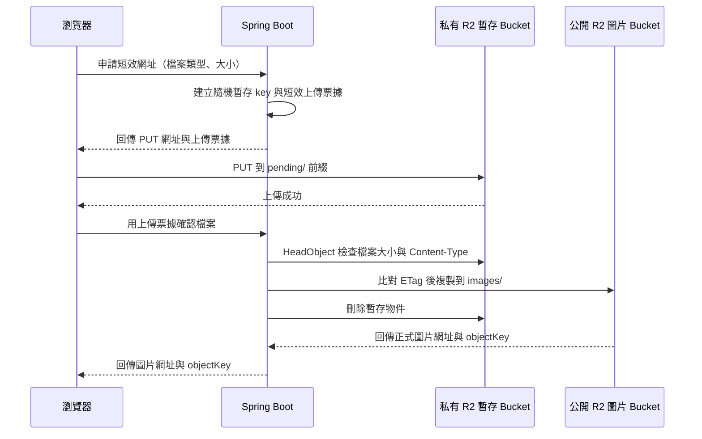

# Cloudflare R2 圖片上傳（React + Spring Boot）

這份教學從 Cloudflare 帳號已註冊開始，帶你建立 R2 儲存空間，並整理本專案串接商品圖片上傳的步驟。

## 先了解本專案目前的狀態

本專案使用 React、Spring Boot 與 MySQL。共用圖片上傳元件、R2 簽名 API 與展示範例已完成；管理菜單畫面仍未接上 `menu_item.image_url` 的儲存流程。

- [菜單與品項規格](../spec/modules/M1-菜單與品項.md)將圖片上傳列為延伸功能，基礎版本可以先使用圖片網址。
- [資料庫規格](../spec/03-資料庫設計.md)的 `menu_item` 已有 `image_url VARCHAR(500)`。
- Northwind 的 `Product` 是練習 API，不是火鍋菜單資料表；請依正式的 `menu_item` 規格串接。

## 上傳流程長什麼樣子

圖片由瀏覽器直接傳到 R2，Spring Boot 驗證檔案資料、簽發短效網址，並在上傳後確認檔案。R2 憑證不會放進 React 前端。現在範例尚未接員工登入或菜單資料庫。



## 1. 啟用 R2 並建立 Bucket

1. 登入 [Cloudflare Dashboard](https://dash.cloudflare.com/)，開啟 **Storage & databases → R2 object storage**。
2. 如果 R2 尚未啟用，先完成畫面上的啟用流程。建立 R2 API token 前，帳號必須先啟用 R2。
3. 選擇 **Create bucket**，建立公開圖片 Bucket，例如 `smart-order-menu-images`，以及另一個私有暫存 Bucket，例如 `smart-order-menu-staging`。名稱使用小寫英文字母、數字與連字號。
4. 兩個 Bucket 的儲存類別都選 **Standard**。R2 的免費額度適用於 Standard，不適用於 Infrequent Access。
5. 暫時上傳一張測試用的菜單圖片，例如 `images/test.webp` 到圖片 Bucket，確認稍後設定公開網址後能載入。

圖片 Bucket 只放完成驗證、可公開展示的圖片；暫存 Bucket 必須保持私有。前端的短效 PUT 網址會指向暫存 Bucket，因此不要替它開啟 Public Development URL 或自訂網域。

R2 Standard 每月免費額度為 10 GB-month 儲存、100 萬次 Class A 操作、1,000 萬次 Class B 操作，對外傳輸免費。超出儲存或操作額度會依用量計費，請在 Dashboard 留意使用量。[R2 定價與免費額度](https://developers.cloudflare.com/r2/pricing/)

## 2. 設定圖片的公開讀取網址

菜單圖片會顯示給所有顧客看，因此圖片可以公開讀取；上傳權限仍由 Spring Boot 控制。

### 開發測試

1. 開啟 `smart-order-menu-images` 圖片 Bucket 的 **Settings**。
2. 在 **Public Development URL** 區塊啟用公開網址。
3. 複製 Cloudflare 提供的 `r2.dev` 網址，打開剛才上傳的測試圖片網址，確認圖片能載入。

`r2.dev` 有流量限制，只適合開發測試。正式環境請將 Bucket 連到你控制的自訂網域，例如 `images.example.com`；該網域必須先加入同一個 Cloudflare 帳號。自訂網域也能使用 Cloudflare Cache。[公開 Bucket 與自訂網域](https://developers.cloudflare.com/r2/buckets/public-buckets/)

> 只有 `smart-order-menu-images` 圖片 Bucket 開啟公開讀取。`smart-order-menu-staging` 暫存 Bucket 不可公開，裡面可能有尚未完成驗證的上傳內容。

## 3. 建立只限此 Bucket 的 R2 API token

1. 在 R2 頁面找到 **Manage API Tokens**，建立 R2 API token。這裡建立的是 R2 的 S3 API 憑證，不是一般 Cloudflare API token。
2. 權限選 **Object Read & Write**，並將範圍限制在 `smart-order-menu-images` 和 `smart-order-menu-staging` 這兩個 Bucket。不要授予帳號內其他 Bucket 的存取權。
3. 建立後立刻複製 **Access Key ID** 與 **Secret Access Key**。Secret Access Key 只會顯示這一次。
4. 在 R2 Overview 找到 **Account ID**。S3 API endpoint 格式如下：

   ```text
   https://<ACCOUNT_ID>.r2.cloudflarestorage.com
   ```

R2 token 與 endpoint 的建立步驟見 [Cloudflare R2 Authentication](https://developers.cloudflare.com/r2/api/tokens/)。Java AWS SDK v2 使用 `Region.of("auto")`；R2 官方範例也列出 Java client 的必要設定。[Java SDK 範例](https://developers.cloudflare.com/r2/examples/aws/aws-sdk-java/)

## 4. 設定瀏覽器上傳的 CORS

React 開發伺服器預設使用 `http://localhost:5173`。到 `smart-order-menu-staging` 暫存 Bucket 的 **Settings → CORS Policy → Add CORS policy → JSON**，加入以下規則。正式前端部署後，把 `https://your-frontend.example.com` 換成實際網址；Origin 要包含協定與網域，不要加路徑。CORS 只需設定在瀏覽器直接 PUT 的私有暫存 Bucket。

```json
[
  {
    "AllowedOrigins": [
      "http://localhost:5173",
      "https://your-frontend.example.com"
    ],
    "AllowedMethods": ["PUT"],
    "AllowedHeaders": ["Content-Type"],
    "ExposeHeaders": ["ETag"],
    "MaxAgeSeconds": 3600
  }
]
```

瀏覽器用短效網址跨來源執行 `PUT` 時，仍會檢查 CORS；即使網址簽章正確，CORS 沒設定好也會被瀏覽器擋下。[R2 CORS 設定](https://developers.cloudflare.com/r2/buckets/cors/)

## 5. 把憑證放在後端環境變數

將以下欄位加到自己本機的 `backend/.env`。`R2_PUBLIC_BASE_URL` 開發時填 `r2.dev` 網址，正式環境改填自訂網域；網址最後不要加 `/`。

```properties
R2_ACCOUNT_ID=你的_ACCOUNT_ID
R2_ACCESS_KEY_ID=你的_ACCESS_KEY_ID
R2_SECRET_ACCESS_KEY=你的_SECRET_ACCESS_KEY
R2_BUCKET_NAME=smart-order-menu-images
R2_STAGING_BUCKET_NAME=smart-order-menu-staging
R2_PUBLIC_BASE_URL=https://你的公開圖片網域
R2_MAX_UPLOAD_BYTES=5242880
```

S3 API endpoint 會由 Account ID 組成：`https://<ACCOUNT_ID>.r2.cloudflarestorage.com`。不要把 Access Key 或 Secret Access Key 放在 `frontend/.env`、React 程式碼、Git commit 或公開訊息裡。正式部署時，將相同欄位設定在後端主機的環境變數／Secrets 設定中，不要依賴開發機的 `backend/.env`。

## 6. 實作 Spring Boot 簽發網址 API

後端已在 `backend/pom.xml` 加入 AWS SDK for Java v2。R2 設定由 `R2StorageProperties` 載入，S3 client 與 presigner 在 `R2StorageConfiguration` 建立；使用 `endpointOverride`、`Region.of("auto")` 和 path-style access。[R2 Java SDK 範例](https://developers.cloudflare.com/r2/examples/aws/aws-sdk-java/)

目前提供以下 API：

```text
GET  /api/uploads/config
POST /api/uploads/presign
POST /api/uploads/complete
```

`/config` 回傳 `R2_MAX_UPLOAD_BYTES`，讓元件使用與後端相同的檔案大小限制。`/presign` 接受 JPEG、PNG、WebP，並建立不可由前端指定 key 的短效上傳票據。PUT 網址有效 10 分鐘，且簽章綁定 Content-Type。物件先傳到私有暫存 Bucket 的 `pending/`；`/complete` 以票據找到該物件，使用 `HeadObject` 檢查實際大小與 Content-Type，再用 ETag 條件複製到公開圖片 Bucket 的 `images/`，最後刪除暫存物件並回傳正式圖片網址與 object key。分開 Bucket 可避免尚未驗證的圖片被公開讀取；ETag 條件可避免檢查後、複製前暫存內容被替換。上傳票據存在單一後端程序的記憶體中，適合本機範例；多實例部署需改用共用儲存。

```text
smart-order-menu-staging: pending/9f0c...a21.webp
        ↓ 檢查與 ETag 條件複製
smart-order-menu-images:  images/9f0c...a21.webp
```

API 實作位於 `backend/src/main/java/tw/ispan/smartorder/controller/ImageUploadController.java` 與 `service/ImageUploadService.java`。`GET /api/uploads/config` 只回傳公開的大小限制；簽發與確認上傳的 POST API（`/api/uploads/presign`、`/api/uploads/complete`）只給登入的店長（`MANAGER`，員工 JWT 由 `StaffJwtFilter` 解析、角色規則在 `SecurityConfig`），沒有匿名開關；沒登入回 401、角色不夠回 403。要試上傳請先用店長帳號登入後台。設定範例在 `backend/.env.example`。

後端只接受 JPEG、PNG、WebP，再由 Content-Type 決定副檔名；不採用前端送來的原始檔名或副檔名。上傳票據與 object key 綁定，前端無法用公開圖片網址要求簽發覆寫網址。

```java
S3Presigner presigner = S3Presigner.builder()
    .endpointOverride(URI.create(endpoint))
    .credentialsProvider(StaticCredentialsProvider.create(
        AwsBasicCredentials.create(accessKey, secretKey)))
    .region(Region.of("auto"))
    .serviceConfiguration(S3Configuration.builder()
        .pathStyleAccessEnabled(true)
        .build())
    .build();

String extension = extensionForValidatedContentType(contentType);
String objectKey = "pending/" + UUID.randomUUID() + extension;

PutObjectRequest putObject = PutObjectRequest.builder()
    .bucket(stagingBucketName) // 私有暫存 Bucket
    .key(objectKey)
    .contentType(contentType)
    .build();

PutObjectPresignRequest request = PutObjectPresignRequest.builder()
    .signatureDuration(Duration.ofMinutes(10))
    .putObjectRequest(putObject)
    .build();

String uploadUrl = presigner.presignPutObject(request).url().toString();
```

API 回傳 `uploadUrl` 與不透明的 `uploadToken`；暫存 key 留在後端。短效網址有效 10 分鐘，並綁定特定暫存 key 和 `Content-Type`。若簽章限制了 `Content-Type`，瀏覽器 PUT 時必須送出完全相同的 header。短效網址等同暫時的上傳權限，不要寫入一般應用程式 log。[R2 Presigned URLs](https://developers.cloudflare.com/r2/api/s3/presigned-urls/)

瀏覽器送來的檔案大小只是申報值；PUT 本身沒有預先限制實際傳輸量。`/complete` 會用 `HeadObject` 比對實際大小與 Content-Type，不符合就刪除暫存物件；未完成確認的 `pending/` 物件則由**私有暫存 Bucket**的 Lifecycle Rule 在一天後到期清除。到 `smart-order-menu-staging` → **Settings → Object Lifecycle Rules**，新增套用 `pending/` 前綴、一天後刪除的規則。[R2 Object Lifecycles](https://developers.cloudflare.com/r2/buckets/object-lifecycles/)。`HeadObject` 讀到的是物件標頭，不會檢查檔案內容；若要確認實際內容是圖片，還要由後端檢查檔案簽章或解碼圖片。

## 7. 從 React 上傳圖片

共用元件位於 `frontend/src/components/upload/ImageUpload.tsx`，上傳 API 呼叫集中在 `frontend/src/services/api/uploads/uploadApi.ts`。元件先讀取後端大小限制，再檢查格式與大小、取得短效網址、直接 PUT 到 R2，最後呼叫 `/complete` 確認檔案。執行範例可開啟前端 `/demo/r2-upload`，或參考 `frontend/src/features/demo/R2UploadDemo.tsx`。

在表單使用：

```ts
const [image, setImage] = useState<UploadedImage | null>(null)

<ImageUpload value={image} onChange={setImage} label="菜單圖片" />
```

上傳成功後，元件回傳 `{ imageUrl, objectKey }`。新增／更新菜單時應傳 `objectKey`，由菜單 API 確認 key 後再寫入資料庫；不要直接信任瀏覽器提交的任意圖片網址。現在的展示元件尚未接到菜單新增／編輯 API。

## 8. 上傳失敗時的前端處理

目前元件的流程是「讀取限制 → 取得簽章 → 上傳 R2 → `/complete` 確認」。確認成功後才呼叫 `onChange`；元件本身不會儲存菜單資料。

| 失敗階段 | 前端行為 | 重試方式 |
|---|---|---|
| 讀取大小限制失敗 | 停用檔案選擇，提示無法讀取後端設定 | 重試讀取設定 API |
| 取得上傳網址失敗 | 保留所選檔案，不呼叫 R2 | 網路或伺服器暫時錯誤時，重試簽發 API |
| PUT 上傳失敗 | 保留檔案與上傳票據，顯示可重試狀態 | 網路中斷或 5xx 可手動重試；網址過期時用同一張票據向後端重新簽發。CORS、Content-Type 不符等設定錯誤先修正再試 |
| `/complete` 確認失敗 | 保留檔案與上傳票據；尚未呼叫 `onChange` | 404 或 409 時重新 PUT 暫存物件；其他暫時錯誤可再次呼叫確認 |

替換既有圖片時，失敗不會呼叫 `onChange`，父層原本保存的圖片值仍在；元件會顯示本次待上傳檔案的預覽。R2 PUT 若因網路中斷而沒有收到回應，前端不一定知道檔案是否已抵達。對同一張圖重試時沿用同一張上傳票據；後端會為同一個暫存 key 重新簽發短效網址，因此不會多建一張正式圖片。若確認 API 回 404，或回 409 表示檢查期間暫存內容改變，元件會用同一張票據重新 PUT 暫存檔，再要求後端確認。

目前元件提供手動重試，不會背景自動重試。每次重試都用相同上傳票據重新取得短效網址；如果 `/complete` 回 404 或 409，元件會重新 PUT 暫存物件。上傳票據過期後需重新取得新票據。R2 PUT 回 403 可先檢查網址是否過期、`Content-Type` 是否與簽章一致、token 和 bucket 權限是否正確。瀏覽器顯示 CORS error 時，檢查前端 Origin、`PUT` 和 `Content-Type` 的 CORS 設定。

菜單資料儲存目前尚未接入。整合菜單表單時，若圖片已完成上傳但菜單儲存失敗，保留 `objectKey` 並只重試菜單儲存；成功儲存新圖片後，再由後端清除未被 `menu_item.image_url` 引用的孤兒圖片與舊圖片。

## 9. 手動確認設定

R2 設定完成後，可依下列順序測試共用元件：

- [ ] 公開圖片 Bucket 與私有暫存 Bucket 都已建立，儲存類別為 Standard。
- [ ] 測試圖片可從開發用公開網址開啟。
- [ ] 只有圖片 Bucket 啟用公開讀取；暫存 Bucket 保持私有。
- [ ] R2 token 僅有這兩個 Bucket 的 Object Read & Write 權限。
- [ ] 暫存 Bucket 的 CORS 已允許 `http://localhost:5173` 的 `PUT` 與 `Content-Type`。
- [ ] 暫存 Bucket 的 Lifecycle Rule 會在一天後刪除 `pending/` 前綴的未完成物件。
- [ ] R2 憑證只設定在後端環境變數。
- [ ] 簽發、確認上傳只有店長（`MANAGER`）登入後才能呼叫；沒有帶員工 token 應回 401。
- [ ] `/demo/r2-upload` 可成功上傳並顯示公開圖片網址。
- [ ] 菜單新增／編輯 API 已將確認過的 `objectKey` 寫入 `menu_item.image_url`（尚未串接）。

### 常見錯誤

| 現象 | 優先檢查 |
|---|---|
| 瀏覽器顯示 CORS error | `AllowedOrigins` 是否逐字符合前端網址（含 `http`／`https` 與 port）、是否允許 `PUT` 和 `Content-Type` |
| PUT 回 403 | 簽章網址是否過期；上傳 `Content-Type` 是否與簽發時相同；Account ID、endpoint、bucket 和 key 是否一致 |
| 上傳成功但圖片打不開 | 是否把圖片 Bucket（而不是暫存 Bucket）設為公開；`image_url` 的網域和 object key 是否正確 |
| Java SDK 寫入回 403 signature mismatch | 若由 Java SDK 直接 `PutObject`，確認 R2 範例要求的 `chunkedEncodingEnabled(false)`；瀏覽器直傳時則先檢查簽章的 headers |

## 官方文件

- [R2 入門與 S3 API](https://developers.cloudflare.com/r2/get-started/s3/)
- [R2 定價](https://developers.cloudflare.com/r2/pricing/)
- [R2 Authentication 與 token 權限](https://developers.cloudflare.com/r2/api/tokens/)
- [公開 Bucket 與自訂網域](https://developers.cloudflare.com/r2/buckets/public-buckets/)
- [Bucket CORS](https://developers.cloudflare.com/r2/buckets/cors/)
- [Presigned URLs](https://developers.cloudflare.com/r2/api/s3/presigned-urls/)
- [AWS SDK for Java v2](https://developers.cloudflare.com/r2/examples/aws/aws-sdk-java/)
